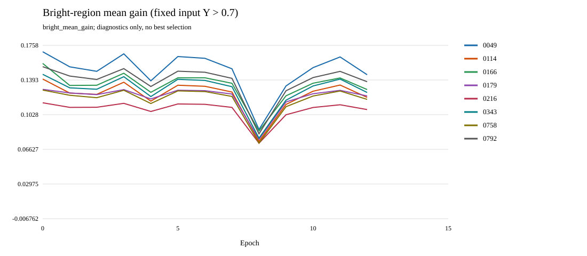
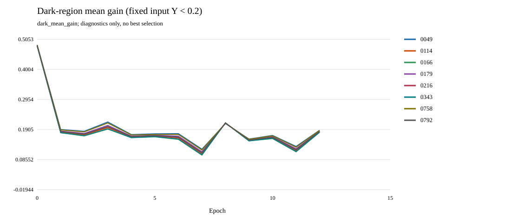
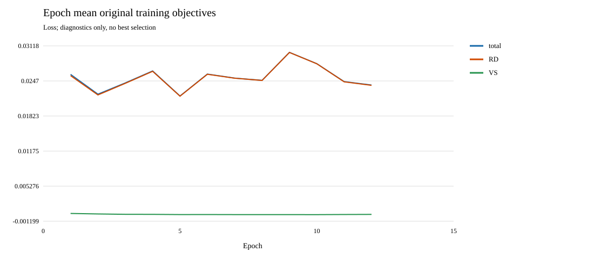
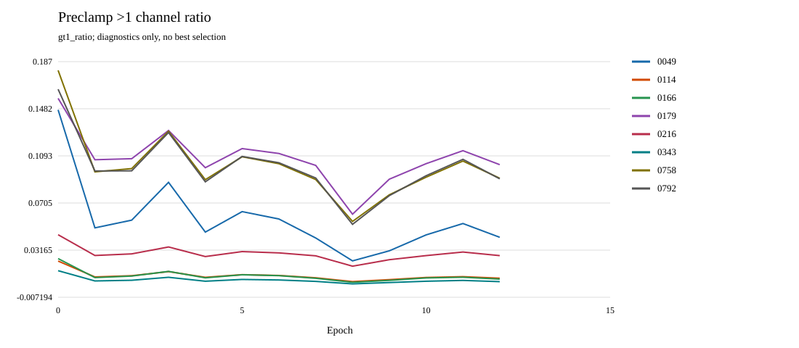
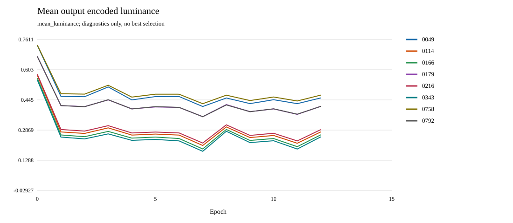

# EXP005A measured curves

Completed epochs: 12 of target 15. Curves contain only fully completed epochs; partial training is excluded from epoch means. Epoch0 is random initialization. Region masks are fixed input masks; empty-region values remain null. No quality score or best epoch is defined.

## bright_mean_gain

## dark_mean_gain

## epoch_loss

## gt1_ratio

## mean_luminance

